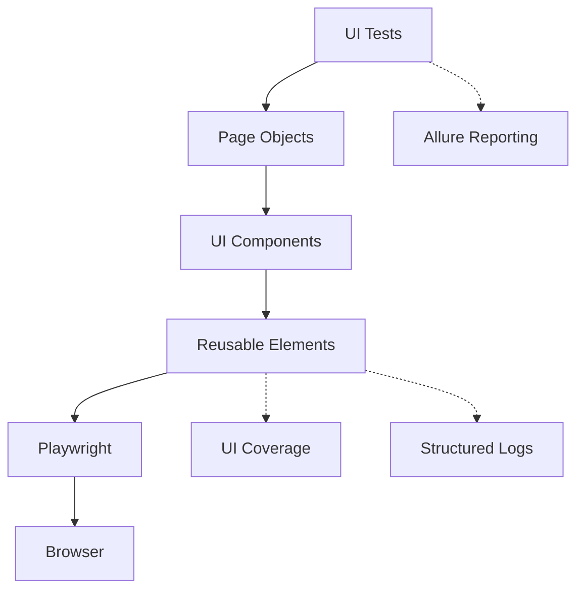

# UI Test Automation Framework

[Russian](README.ru.md)

[](https://github.com/Barbaron86/autotest-ui/actions/workflows/ci.yml)


UI test automation framework for a learning management system, built with
**Python**, **Playwright** and **pytest**. Layered Page Objects, reusable components
and elements keep scenarios readable across Chromium, Firefox and WebKit.
Parallel execution, traces, videos, logs and UI interaction coverage support
regression testing, with reports published by GitHub Actions.

Test application: [UI Course](https://nikita-filonov.github.io/qa-automation-engineer-ui-course/#/auth/login)
([source](https://github.com/Nikita-Filonov/qa-automation-engineer-ui-course)).

[Allure Report](https://barbaron86.github.io/autotest-ui/main/) ·
[UI Coverage](https://barbaron86.github.io/autotest-ui/ui-coverage/coverage.html) ·
[GitHub Actions](https://github.com/Barbaron86/autotest-ui/actions)

## 📑 Contents

[Quick Start](#-quick-start) · [Tech Stack](#-tech-stack) ·
[Test Scenarios](#-test-scenarios) · [Architecture](#-architecture) ·
[Project Structure](#-project-structure) · [Running Tests](#-running-tests) ·
[Reports](#-reports) · [Code Quality & CI/CD](#-code-quality--cicd)

## 🚀 Quick Start

Requirements: **Python 3.12+**, **Poetry 2.x** and access to the test application.
**Allure Commandline** is needed only to view Allure reports locally.

1. Clone the repository:

   ```bash
   git clone https://github.com/Barbaron86/autotest-ui.git
   cd autotest-ui
   ```

2. Create your local configuration from [.env.example](.env.example):

   ```bash
   cp .env.example .env
   ```

   On Windows PowerShell, use `Copy-Item .env.example .env`.

3. Install dependencies and browsers, then run the regression suite:

   ```bash
   poetry env use 3.12
   poetry install --no-root
   poetry run python -m playwright install chromium firefox webkit
   poetry run pytest tests -m regression
   ```

On Linux, add `--with-deps` to the browser installation command to install system dependencies, as in CI.
The `.env` file defines `APP_URL`, `HEADLESS`, `BROWSERS`, `TEST_USER__*`,
`TEST_DATA__IMAGE_PNG_FILE` and UI Coverage settings. Environment variables override `.env`.
Browser fixtures run scenarios for each entry in `BROWSERS`; the example enables all three browsers.

## 🧰 Tech Stack

| Tool | Role in the project |
| :--- | :--- |
| **Python 3.12+** | Framework and test implementation; CI runs on Python 3.12. |
| **Playwright / pytest-playwright** | Browser automation, auto-waiting assertions and pytest integration. |
| **pytest** | Test execution, fixtures, parametrization and selection by markers. |
| **pytest-xdist** | Parallel execution in separate worker processes. |
| **pytest-rerunfailures** | Optional test retries through `--reruns`; disabled by default. |
| **Pydantic / Pydantic Settings** | Typed configuration and validation of user data, paths and environment settings. |
| **Allure / allure-pytest** | Test hierarchy, steps, logs, trace/video attachments and environment details. |
| **UI Coverage Tool** | Records interactions through the element layer and generates coverage reports. |
| **Loguru** | Structured framework logs and per-test log attachments in Allure. |
| **Poetry** | Dependencies, virtual environments and locked package versions. |
| **Ruff** | Linting, import checks and formatting. |
| **mypy** | Strict framework type checking with practical overrides for tests and fixtures. |
| **GitHub Actions** | Quality checks, test execution and report publication. |
| **AI Review** | Optional OpenAI-assisted pull request review through a separate workflow. |

Dependency constraints and tool settings: [pyproject.toml](pyproject.toml).
Exact package versions: [poetry.lock](poetry.lock).

## 🧪 Test Scenarios

| Area | Implemented scenarios |
| :--- | :--- |
| **Registration** | Registration with valid email, username and password. |
| **Authorization** | Successful login, invalid credentials and navigation to registration. |
| **Dashboard** | Display of the dashboard for an authenticated user. |
| **Courses** | Empty course list, form readiness, preview image upload, course creation and editing. |
| **Infrastructure** | Isolation of Allure log attachments between tests. |

UI scenarios verify navigation, visible state and displayed data through reusable
Page Objects and components. Infrastructure checks are separate from the regression suite.

## 🧩 Architecture



Tests describe user scenarios; pages and components encapsulate UI interaction details.
The element layer centralizes locators, common actions, assertions, logging,
Allure steps and UI interaction coverage. Fixtures manage browser contexts and test pages.

### Design Decisions

- **Layered UI architecture** — reusable Pages, Components and Elements keep browser
  interaction details out of test scenarios and reduce duplication.
- **Stable locators** — `data-testid` provides an explicit locator contract,
  reducing dependence on visual styling and page markup.
- **In-memory authentication** — session-scoped `StorageState` is reused within each
  pytest worker, avoiding repeated registration and authentication state files.
- **Centralized diagnostics** — shared infrastructure collects traces, videos and
  per-test logs so scenarios stay focused on behavior and failures are easier to investigate.

## 📁 Project Structure

Main source and configuration files; generated reports and caches are omitted.

```text
autotest-ui/
├── pages/               # Page Objects
├── components/          # Reusable UI components
├── elements/            # Common actions, locators, assertions and UI coverage
├── fixtures/            # Pages, browser contexts, authentication state and Allure
├── tests/
│   ├── authentication/  # Registration and authorization
│   ├── courses/         # Course creation and editing
│   ├── dashboard/       # Authenticated dashboard
│   └── infrastructure/  # Framework checks
├── tools/
│   ├── playwright/      # Browser/page setup, diagnostics and static resource mocks
│   ├── allure/          # Report metadata, environment details and test log capture
│   ├── logger.py        # Structured console logging
│   └── routes.py        # Application routes
├── testdata/files/      # Upload test assets
├── .github/
│   ├── workflows/
│   │   ├── ci.yml       # Quality checks, UI tests and report publication
│   │   └── ai-review.yml # Manually triggered pull request review
│   └── ai-review/python-qa-review.md # UI-specific review instructions
├── .ai-review.yaml      # AI provider, prompts and review settings
├── .env.example         # Application, browser, user and coverage settings
├── config.py            # Typed configuration
├── conftest.py          # pytest plugins and logging setup
├── pyproject.toml       # Dependencies and tool configuration
└── poetry.lock          # Locked package versions
```

## ▶️ Running Tests

```bash
# Complete regression suite
poetry run pytest tests -m regression
# Parallel execution, as in CI
poetry run pytest tests -m regression --numprocesses auto
# Select a functional area
poetry run pytest tests -m authorization
poetry run pytest tests -m registration
poetry run pytest tests -m courses
poetry run pytest tests -m dashboard
# Framework infrastructure checks
poetry run pytest tests/infrastructure -m infrastructure
```

Available markers: `regression`, `registration`, `authorization`, `courses`, `dashboard`, `infrastructure`.
Set `BROWSERS=["chromium"]` in `.env` to run UI scenarios in one browser.
Set `HEADLESS=false` to show browser windows during local execution.

## 📊 Reports

### Allure

Enable Allure results explicitly; the flags are also used in CI:

```bash
poetry run pytest tests -m regression --alluredir=allure-results --clean-alluredir
allure serve allure-results
```

Reports include test hierarchy, severity, steps, environment details and a separate
`Test log` attachment for each test. UI page fixtures also save Playwright traces
to `tracing/` and videos to `videos/`, attaching them to Allure.

### UI Coverage

Records actions and assertions performed through the element layer. Run the UI
tests, then generate the report from the recorded results:

```bash
poetry run pytest tests -m regression --numprocesses auto
poetry run ui-coverage-tool save-report
```

Open `coverage.html` in a browser. JSON results and coverage history are also saved;
paths are configured in `.env.example`. Log verbosity and colors can be adjusted
with `LOGURU_LEVEL` and `LOGURU_COLORIZE`.

## 🔍 Code Quality & CI/CD

Run the same quality checks used in CI:

```bash
poetry check --lock
poetry run ruff format --check .
poetry run ruff check .
poetry run mypy .
```

The [CI workflow](.github/workflows/ci.yml) validates code, installs all three browsers
and their system dependencies, runs regression tests with `--numprocesses auto`
and publishes reports. CI uses Python **3.12** and Poetry **2.4.3**.

| Trigger | Reporting |
| :--- | :--- |
| **Push to `main`** | Publishes Allure; successful regression and coverage generation also update public UI Coverage and its cached history. |
| **Pull request to `main`** | Publishes Allure under `pr-<number>/`; generated UI Coverage is uploaded as an artifact. |

UI Coverage artifacts are retained for **30 days**. CI restores Allure history
from GitHub Pages and reuses cached UI Coverage history; only pushes to `main` update that cache.

### AI Review

The optional [AI review workflow](.github/workflows/ai-review.yml) uses
`Nikita-Filonov/ai-review` with OpenAI to review PR changes separately from the test pipeline.
Start it from **GitHub Actions → AI Review → Run workflow**, enter the PR number
and select a command such as `run-summary` or `run-inline`.
It requires an `OPENAI_API_KEY` repository secret.
[.ai-review.yaml](.ai-review.yaml) configures the provider and review behavior;
[python-qa-review.md](.github/ai-review/python-qa-review.md) contains project-specific review instructions.
