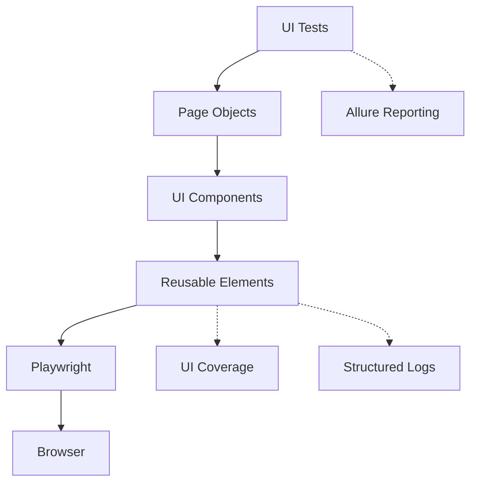

# UI Test Automation Framework

[English](README.md)

[](https://github.com/Barbaron86/autotest-ui/actions/workflows/ci.yml)


Фреймворк автоматизации UI-тестов системы управления обучением на **Python**,
**Playwright** и **pytest**. Слои Page Objects, переиспользуемые Components и Elements
сохраняют читаемость сценариев для Chromium, Firefox и WebKit.
Параллельный запуск, traces, videos, logs и UI Coverage помогают выполнять
регрессионные тесты. Отчёты публикуются через GitHub Actions.

Тестируемое приложение: [UI Course](https://nikita-filonov.github.io/qa-automation-engineer-ui-course/#/auth/login)
([исходный код](https://github.com/Nikita-Filonov/qa-automation-engineer-ui-course)).

[Allure Report](https://barbaron86.github.io/autotest-ui/main/) ·
[UI Coverage](https://barbaron86.github.io/autotest-ui/ui-coverage/coverage.html) ·
[GitHub Actions](https://github.com/Barbaron86/autotest-ui/actions)

## 📑 Содержание

[Быстрый старт](#-быстрый-старт) · [Технологии](#-технологии) ·
[Тестовые сценарии](#-тестовые-сценарии) · [Архитектура](#-архитектура) ·
[Структура проекта](#-структура-проекта) · [Запуск тестов](#-запуск-тестов) ·
[Отчёты](#-отчёты) · [Качество кода и CI/CD](#-качество-кода-и-cicd)

## 🚀 Быстрый старт

Требуются **Python 3.12+**, **Poetry 2.x** и доступ к тестируемому приложению.
**Allure Commandline** нужен только для локального просмотра отчётов Allure.

1. Клонируйте репозиторий:

   ```bash
   git clone https://github.com/Barbaron86/autotest-ui.git
   cd autotest-ui
   ```

2. Создайте локальную конфигурацию из [.env.example](.env.example):

   ```bash
   cp .env.example .env
   ```

   В Windows PowerShell используйте `Copy-Item .env.example .env`.

3. Установите зависимости и браузеры, затем выполните регрессионные тесты:

   ```bash
   poetry env use 3.12
   poetry install --no-root
   poetry run python -m playwright install chromium firefox webkit
   poetry run pytest tests -m regression
   ```

В Linux добавьте `--with-deps` к команде установки браузеров для установки системных зависимостей, как в CI.
Файл `.env` задаёт `APP_URL`, `HEADLESS`, `BROWSERS`, `TEST_USER__*`,
`TEST_DATA__IMAGE_PNG_FILE` и настройки UI Coverage. Переменные окружения имеют приоритет над `.env`.
Browser fixtures запускают сценарии для каждого значения в `BROWSERS`; пример включает все три браузера.

## 🧰 Технологии

| Инструмент | Назначение в проекте |
| :--- | :--- |
| **Python 3.12+** | Реализация фреймворка и тестов; в CI используется Python 3.12. |
| **Playwright / pytest-playwright** | Автоматизация браузера, assertions с автоматическим ожиданием и интеграция с pytest. |
| **pytest** | Запуск тестов, fixtures, параметризация и выбор тестов по markers. |
| **pytest-xdist** | Параллельное выполнение в отдельных workers. |
| **pytest-rerunfailures** | Необязательные повторные запуски через `--reruns`; по умолчанию отключены. |
| **Pydantic / Pydantic Settings** | Типизированная конфигурация и проверка данных пользователя, путей и настроек окружения. |
| **Allure / allure-pytest** | Иерархия тестов, steps, logs, вложения trace/video и сведения об окружении. |
| **UI Coverage Tool** | Запись взаимодействий через слой Elements и создание отчётов о покрытии. |
| **Loguru** | Структурированные logs фреймворка и отдельные вложения logs для тестов в Allure. |
| **Poetry** | Зависимости, виртуальные окружения и фиксация версий пакетов. |
| **Ruff** | Проверка кода, импортов и форматирования. |
| **mypy** | Строгая проверка типов фреймворка с практичными исключениями для тестов и fixtures. |
| **GitHub Actions** | Проверки качества, запуск тестов и публикация отчётов. |
| **AI Review** | Необязательное ревью pull request с помощью OpenAI в отдельном workflow. |

Ограничения версий зависимостей и настройки инструментов: [pyproject.toml](pyproject.toml).
Точные версии пакетов: [poetry.lock](poetry.lock).

## 🧪 Тестовые сценарии

| Область | Реализованные сценарии |
| :--- | :--- |
| **Registration** | Регистрация с корректными email, username и password. |
| **Authorization** | Успешный вход, некорректные учётные данные и переход к регистрации. |
| **Dashboard** | Отображение dashboard для авторизованного пользователя. |
| **Courses** | Пустой список курсов, готовность формы, загрузка preview image, создание и редактирование курса. |
| **Infrastructure** | Изоляция вложений logs в Allure между тестами. |

UI-сценарии проверяют навигацию, видимое состояние и отображаемые данные через
переиспользуемые Page Objects и Components. Infrastructure checks выполняются отдельно от regression suite.

## 🧩 Архитектура



Тесты описывают пользовательские сценарии; Pages и Components скрывают детали взаимодействия с UI.
Слой Elements объединяет locators, общие actions, assertions, logging,
Allure steps и UI Coverage. Fixtures управляют browser contexts и страницами тестов.

### Design Decisions

- **Layered UI architecture** — переиспользуемые Pages, Components и Elements выносят
  детали взаимодействия с браузером из тестовых сценариев и сокращают дублирование.
- **Stable locators** — `data-testid` задаёт явный контракт для locators,
  уменьшая зависимость от визуальных стилей и разметки страницы.
- **In-memory authentication** — session-scoped `StorageState` переиспользуется внутри каждого
  pytest worker, позволяя избежать повторной регистрации и файлов состояния авторизации.
- **Centralized diagnostics** — общая инфраструктура собирает traces, videos и
  logs каждого теста, чтобы сценарии описывали поведение, а причины падений было проще выяснить.

## 📁 Структура проекта

Основные исходные файлы и конфигурация; сгенерированные отчёты и кеши не показаны.

```text
autotest-ui/
├── pages/               # Page Objects
├── components/          # Переиспользуемые UI Components
├── elements/            # Общие actions, locators, assertions и UI Coverage
├── fixtures/            # Pages, browser contexts, состояние авторизации и Allure
├── tests/
│   ├── authentication/  # Registration и Authorization
│   ├── courses/         # Создание и редактирование курса
│   ├── dashboard/       # Dashboard авторизованного пользователя
│   └── infrastructure/  # Проверки фреймворка
├── tools/
│   ├── playwright/      # Настройка browser/page, diagnostics и mocks статических ресурсов
│   ├── allure/          # Метаданные отчётов, сведения об окружении и сбор logs тестов
│   ├── logger.py        # Структурированное консольное logging
│   └── routes.py        # Маршруты приложения
├── testdata/files/      # Файлы для тестов загрузки
├── .github/
│   ├── workflows/
│   │   ├── ci.yml       # Проверки качества, UI-тесты и публикация отчётов
│   │   └── ai-review.yml # Ревью pull request, запускаемое вручную
│   └── ai-review/python-qa-review.md # Инструкции ревью UI-проекта
├── .ai-review.yaml      # Провайдер AI, инструкции и настройки ревью
├── .env.example         # Настройки приложения, браузеров, пользователя и покрытия
├── config.py            # Типизированная конфигурация
├── conftest.py          # Плагины pytest и настройка logging
├── pyproject.toml       # Зависимости и настройки инструментов
└── poetry.lock          # Зафиксированные версии пакетов
```

## ▶️ Запуск тестов

```bash
# Полный набор регрессионных тестов
poetry run pytest tests -m regression
# Параллельный запуск, как в CI
poetry run pytest tests -m regression --numprocesses auto
# Выбор функциональной области
poetry run pytest tests -m authorization
poetry run pytest tests -m registration
poetry run pytest tests -m courses
poetry run pytest tests -m dashboard
# Infrastructure checks фреймворка
poetry run pytest tests/infrastructure -m infrastructure
```

Доступные markers: `regression`, `registration`, `authorization`, `courses`, `dashboard`, `infrastructure`.
Задайте `BROWSERS=["chromium"]` в `.env` для запуска UI-сценариев в одном браузере.
Задайте `HEADLESS=false`, чтобы видеть окна браузеров при локальном запуске.

## 📊 Отчёты

### Allure

Включите сохранение результатов Allure явно; эти flags также используются в CI:

```bash
poetry run pytest tests -m regression --alluredir=allure-results --clean-alluredir
allure serve allure-results
```

Отчёты содержат иерархию тестов, severity, steps, сведения об окружении и отдельное
вложение `Test log` для каждого теста. UI page fixtures также сохраняют Playwright traces
в `tracing/` и videos в `videos/`, прикрепляя их к Allure.

### UI Coverage

Записывает actions и assertions, выполненные через слой Elements. Запустите
UI-тесты, затем создайте отчёт из записанных результатов:

```bash
poetry run pytest tests -m regression --numprocesses auto
poetry run ui-coverage-tool save-report
```

Откройте `coverage.html` в браузере. Также сохраняются JSON-результаты и история
покрытия; пути настроены в `.env.example`. Уровень logging и цвета задаются
через `LOGURU_LEVEL` и `LOGURU_COLORIZE`.

## 🔍 Качество кода и CI/CD

Запустите проверки качества, используемые в CI:

```bash
poetry check --lock
poetry run ruff format --check .
poetry run ruff check .
poetry run mypy .
```

[CI workflow](.github/workflows/ci.yml) проверяет код, устанавливает все три браузера
и их системные зависимости, выполняет регрессионные тесты с `--numprocesses auto`
и публикует отчёты. В CI используются Python **3.12** и Poetry **2.4.3**.

| Событие | Отчётность |
| :--- | :--- |
| **Push в `main`** | Публикует Allure; успешные regression и генерация покрытия также обновляют публичный UI Coverage и его кешированную историю. |
| **Pull request в `main`** | Публикует Allure в `pr-<number>/`; сформированный UI Coverage загружается как артефакт. |

Артефакты UI Coverage хранятся **30 дней**. CI восстанавливает историю Allure
из GitHub Pages и использует кешированную историю UI Coverage; кеш обновляют только push в `main`.

### AI Review

Необязательный [workflow AI review](.github/workflows/ai-review.yml) использует
`Nikita-Filonov/ai-review` с OpenAI для ревью изменений PR отдельно от тестового pipeline.
Откройте **GitHub Actions → AI Review → Run workflow**, укажите номер PR
и выберите команду, например `run-summary` или `run-inline`.
Требуется секрет репозитория `OPENAI_API_KEY`.
[.ai-review.yaml](.ai-review.yaml) задаёт провайдера и поведение ревью;
[python-qa-review.md](.github/ai-review/python-qa-review.md) содержит инструкции ревью для этого проекта.
